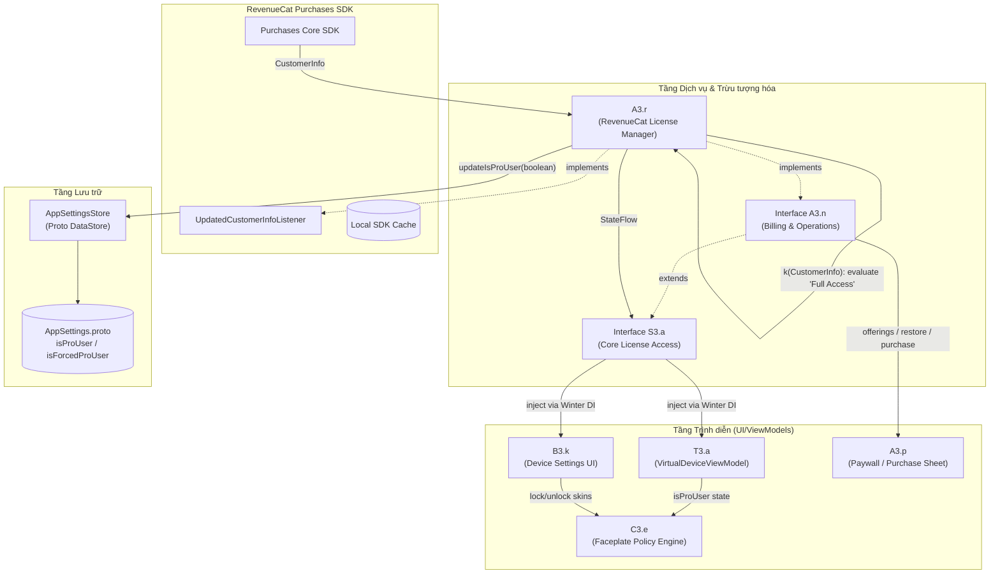

# Kiến trúc Kiểm thử Bản quyền & Trạng thái Cấp phép (License Test Architecture)

> **Tài liệu**: Phân tích kiến trúc xác thực bản quyền & Thiết kế môi trường kiểm thử cách ly (Isolated Test Environment)  
> **Ứng dụng mục tiêu**: Elgato Stream Deck Mobile 2.1.2 (`com.elgato.streamdeck`)  
> **Ngày lập**: 13/10/2026  
> **Trạng thái**: Hoàn thành phân tích mã nguồn thực tế

---

## 1. Tổng quan Kiến trúc Xác thực Bản quyền

Hệ thống cấp phép của Elgato Stream Deck Mobile phiên bản 2.1.2 được thiết kế dựa trên mô hình **Multi-Tier Reactive State Flow**, tích hợp RevenueCat SDK (bên thứ ba), DataStore Protobuf (bộ nhớ cục bộ) và Winter Dependency Injection framework.



---

## 2. Phân tích Chi tiết Từng Thành phần theo Mã nguồn Thực tế

### 2.1. Thu thập `CustomerInfo` (CustomerInfo Acquisition)
- **Tệp xác thực**: [`recovered/java/A3/r.java`](file:///data/Codebase/Stream%20Deck%20Pro/Stream-Deck-origin-source/recovered/java/A3/r.java)
- **Cơ chế**:
  1. `A3.r` đóng vai trò là một singleton triển khai `UpdatedCustomerInfoListener` từ RevenueCat SDK.
  2. Khi ứng dụng khởi động và RevenueCat SDK thiết lập xong (hoặc khi token ứng dụng thay đổi), SDK tự động gọi callback:
     ```java
     @Override
     public void onReceived(CustomerInfo customerInfo) {
         Intrinsics.checkNotNullParameter(customerInfo, "customerInfo");
         k(customerInfo);
     }
     ```
  3. Khi có yêu cầu làm mới dữ liệu từ UI (`A3.n.f()` -> `A3.r.f()`), phương thức gọi trực tiếp SDK:
     ```java
     Purchases.getSharedInstance().getCustomerInfo(new ReceiveCustomerInfoCallback() { ... });
     ```
  4. Khi thực hiện khôi phục mua hàng (`A3.n.e()` -> `A3.r.e()`), SDK gọi `Purchases.getSharedInstance().restorePurchases(...)` và trả về `CustomerInfo` trong callback thành công.

### 2.2. Đánh giá Active Entitlements (Entitlement Evaluation)
- **Tệp xác thực**: [`recovered/java/A3/r.java:k(CustomerInfo)`](file:///data/Codebase/Stream%20Deck%20Pro/Stream-Deck-origin-source/recovered/java/A3/r.java)
- **Khóa Entitlement duy nhất**: Chuỗi ký tự `"Full Access"`.
- **Logic kiểm tra**:
  ```java
  public final void k(CustomerInfo customerInfo) {
      EntitlementInfo entitlementInfo = (EntitlementInfo) customerInfo.getEntitlements().getAll().get("Full Access");
      boolean z4 = entitlementInfo != null && entitlementInfo.isActive();
      // Emit sang StateFlow
      this.f66e.setValue(Boolean.valueOf(z4));
      // Ghi xuống DataStore
      BuildersKt__Builders_commonKt.launch$default(this.f63b, null, null, new r$b(this, z4, null), 3, null);
  }
  ```
  - Phương thức trích xuất `EntitlementInfo` tương ứng với khóa `"Full Access"` từ bản đồ `customerInfo.getEntitlements().getAll()`.
  - Kiểm tra điều kiện: đối tượng tồn tại (`!= null`) **và** cờ `entitlementInfo.isActive() == true`.
  - Nếu thỏa mãn, người dùng được xem là có quyền Pro (`z4 = true`); ngược lại là `false`.

### 2.3. Cơ chế Lưu trữ & Duy trì Trạng thái (Persistence & State Management)
- **Tệp xác thực**: 
  - [`recovered/java/com/elgato/streamdeck/vsd2/AppSettingsStore.java`](file:///data/Codebase/Stream%20Deck%20Pro/Stream-Deck-origin-source/recovered/java/com/elgato/streamdeck/vsd2/AppSettingsStore.java)
  - [`recovered/assets/AppSettings.proto`](file:///data/Codebase/Stream%20Deck%20Pro/Stream-Deck-origin-source/recovered/assets/AppSettings.proto)
- **Lưu trữ nhị phân**:
  - `AppSettingsStore` sử dụng Jetpack DataStore với định dạng Google Protobuf.
  - Trường Protobuf số 5: `optional bool isProUser = 5;`.
  - Trong phương thức `r$b`: `AppSettingsStore.updateIsProUser(z4, continuation)`.
- **Cờ kiểm thử nội bộ của nhà phát triển (Debug Override Flag)**:
  - Tại dòng 98 của `AppSettings.proto`:
    ```protobuf
    optional bool isForcedProUser = 6; // debug build override
    ```
  - Tại `AppSettingsStore.java`:
    ```java
    public final Object updateIsForcedProUser(Boolean bool, Continuation continuation)
    ```
  - Đây là cờ ghi đè chính thống được lập trình viên Elgato thiết kế riêng cho các bản build Debug/Internal nhằm kiểm thử độc lập mà không cần kết nối tới RevenueCat server.

### 2.4. Lan truyền Trạng thái đến Giao diện (State Propagation to UI)
Hệ thống sử dụng cơ chế trừu tượng 2 tầng qua Dependency Injection (Winter DI):
1. **Interface Cơ sở `S3.a`**:
   - Tệp: [`recovered/java/S3/a.java`](file:///data/Codebase/Stream%20Deck%20Pro/Stream-Deck-origin-source/recovered/java/S3/a.java)
   - Cung cấp:
     - `boolean c()`: Kiểm tra trạng thái tức thời (`isProUser`).
     - `StateFlow<Boolean> d()`: Cung cấp luồng trạng thái phản ứng cho UI.
2. **Interface Mở rộng `A3.n`**:
   - Tệp: [`recovered/java/A3/n.java`](file:///data/Codebase/Stream%20Deck%20Pro/Stream-Deck-origin-source/recovered/java/A3/n.java)
   - Kế thừa `S3.a` và bổ sung các hàm nghiệp vụ mua hàng:
     - `a()`: Lấy danh sách gói cước (Offerings).
     - `b()`: Thực hiện mua gói cước (Purchase Package).
     - `e()`: Khôi phục giao dịch cũ (Restore Purchases).
     - `f()`: Làm mới thông tin khách hàng (Refresh CustomerInfo).
     - `g()`: Lấy mã người dùng (App User ID).
     - `h()`: Lấy trạng thái Entitlements thô.

### 2.5. Các Tính năng Phụ thuộc Bản quyền (License-Dependent Features)
Mã nguồn thực tế cho thấy các tính năng bị chi phối bởi `isProUser`:
1. **Khóa Faceplate/Skin (Vỏ phím ảo)**:
   - Tệp: [`recovered/java/C3/e.java:c(Device, boolean)`](file:///data/Codebase/Stream%20Deck%20Pro/Stream-Deck-origin-source/recovered/java/C3/e.java)
   - Nếu `isProUser == false`, phương thức `C3.e.c()` sẽ tự động hủy chọn các skin tùy chỉnh (Custom Faceplates) và ép buộc đặt về giao diện mặc định `b.h ("Classic")`:
     ```java
     if (!isProUser) {
         return b.h; // Classic Default Faceplate
     }
     ```
2. **Cấu hình Thiết bị Ảo (Virtual Device Grid & Settings)**:
   - Tệp: [`recovered/java/B3/k.java`](file:///data/Codebase/Stream%20Deck%20Pro/Stream-Deck-origin-source/recovered/java/B3/k.java) và [`recovered/java/T3/a.java`](file:///data/Codebase/Stream%20Deck%20Pro/Stream-Deck-origin-source/recovered/java/T3/a.java)
   - `T3.a` (VirtualDeviceViewModel) lắng nghe `S3.a.d()` để build view-state `C0274a(knownHost, device, isProUser)`. Khi `isProUser == false`, các nút tính năng nâng cao và lựa chọn faceplate trong menu thiết bị bị ẩn hoặc hiển thị biểu tượng ổ khóa mở ra Paywall.
3. **Màn hình Paywall / Nâng cấp**:
   - Khi người dùng bấm vào các tính năng bị khóa, UI điều hướng tới màn hình thanh toán thông qua `A3.p`, hiển thị các gói từ `A3.n.a()`.

### 2.6. Xử lý Lỗi và Hết hạn Thuê bao (Error & Expiry Handling)
1. **Khi thuê bao hết hạn**:
   - `entitlementInfo.isActive()` trả về `false`.
   - `A3.r.k()` nhận diện `z4 = false`, lập tức cập nhật `StateFlow` và `AppSettingsStore`.
   - Giao diện ngay lập tức cập nhật thông qua Flow: các skin tùy chỉnh đang áp dụng bị gỡ bỏ, UI quay về Classic layout.
2. **Khi mất kết nối mạng (Network Offline)**:
   - RevenueCat SDK sử dụng bộ nhớ đệm SQLite/SharedPreferences trên máy.
   - Nếu không có mạng và không có bản ghi đệm, phương thức callback `onError(PurchasesError)` được gọi.
   - `A3.r` không ghi đè giá trị `false` mù quáng mà duy trì trạng thái lưu gần nhất trong `AppSettingsStore`.
3. **Khi khôi phục gói cước thất bại**:
   - `restorePurchases` gọi `onError(PurchasesError)`.
   - UI hiển thị thông báo lỗi tương ứng mà không làm thay đổi trạng thái `isProUser` hiện tại.

---

## 3. Thiết kế Môi trường Kiểm thử Cách ly (Test Harness Architecture)

Để đáp ứng tiêu chuẩn kiểm thử công nghiệp mà không can thiệp vào logic release hay làm giả server receipt, hệ thống kiểm thử được thiết kế tách rời hoàn toàn bằng cách tận dụng cơ chế Dependency Injection của dự án.

### 3.1. Điểm Tiêm Phụ thuộc (Injection Points)
Trong production, Winter DI đăng ký:
```kotlin
// Production Binding
singleton<S3.a> { A3.r(get(), get(), get()) }
singleton<A3.n> { get<A3.r>() }
```

Trong Test Environment (hoặc Debug Build Variant):
```kotlin
// Test / Debug Binding
singleton<S3.a> { MockLicenseManager() }
singleton<A3.n> { MockLicenseManager() }
```

### 3.2. 6 Trạng thái Cấp phép Mô phỏng (Simulated License States)

| Trạng thái | Mô tả kỹ thuật | `isProUser` | `isActive()` | Dữ liệu mô phỏng | Phản ứng UI mong đợi |
|---|---|---|---|---|---|
| **1. Entitlement Active** | Bản quyền đang hoạt động bình thường | `true` | `true` | `"Full Access"` hợp lệ, `expirationDate` trong tương lai | Mở khóa toàn bộ Faceplate, cho phép đổi skin, ẩn nút Paywall |
| **2. Entitlement Absent** | Tài khoản miễn phí (chưa từng mua) | `false` | `false` | Entitlements map rỗng (`emptyMap()`) | Khóa skin về Classic, hiển thị biểu tượng Pro/Paywall |
| **3. Subscription Expired** | Thuê bao đã hết hạn thanh toán | `false` | `false` | Có key `"Full Access"`, nhưng `expirationDate` quá khứ, `isActive = false` | Tự động hạ cấp về Classic, hiển thị cảnh báo gia hạn gói |
| **4. Network Unavailable** | Mất mạng khi kiểm tra/mua | Giữ cache (`true`/`false`) | N/A | Ném `PurchasesError(NETWORK_ERROR)` | Hiển thị thông báo mất kết nối, giữ nguyên trạng thái cache |
| **5. Restore Success** | Khôi phục mua hàng thành công | `true` | `true` | Trả về `CustomerInfo` hợp lệ sau lệnh `restorePurchases()` | Cập nhật UI sang Pro ngay lập tức, tắt popup |
| **6. Restore Failure** | Khôi phục thất bại (không có đơn) | `false` | `false` | Ném `PurchasesError(PURCHASE_NOT_ALLOWED / NOT_FOUND)` | Hiển thị lỗi thông báo người dùng không có bản quyền cũ |

---

## 4. Ranh giới An toàn & Tuân thủ (Safety Guardrails)

Môi trường kiểm thử tuân thủ nghiêm ngặt các nguyên tắc sau:
1. **Zero Production Mutation**: Không chỉnh sửa bất kỳ tệp nào trong `recovered/java/A3/r.java` hay logic của RevenueCat SDK.
2. **Tách biệt Mã nguồn**: Toàn bộ mã nguồn test harness nằm trong thư mục độc lập `test/licensing/`, tách rời khỏi cây mã nguồn dịch ngược `recovered/`.
3. **Không Giả mạo Biên lai**: Không cố gắng tạo ra các hóa đơn Google Play giả lập hay can thiệp vào máy chủ xác thực.
4. **Build Variant Isolation**: Sử dụng pattern Mock/Fake thông qua interface `S3.a` và `A3.n`. Trong release build thực tế, Proguard/R8 sẽ loại bỏ hoàn toàn các lớp trong `test/`.

---

## 5. Kết luận & Bước tiếp theo

Kiến trúc xác thực bản quyền của Stream Deck Mobile 2.1.2 có tính mô-đun cao nhờ interface `S3.a` và `A3.n`. Thiết kế Test Harness bằng cách triển khai một `MockLicenseManager` độc lập là giải pháp tối ưu nhất, vừa cho phép kiểm thử toàn diện cả 6 kịch bản bản quyền, vừa bảo đảm 100% tính nguyên bản và bảo mật của mã nguồn ứng dụng.
